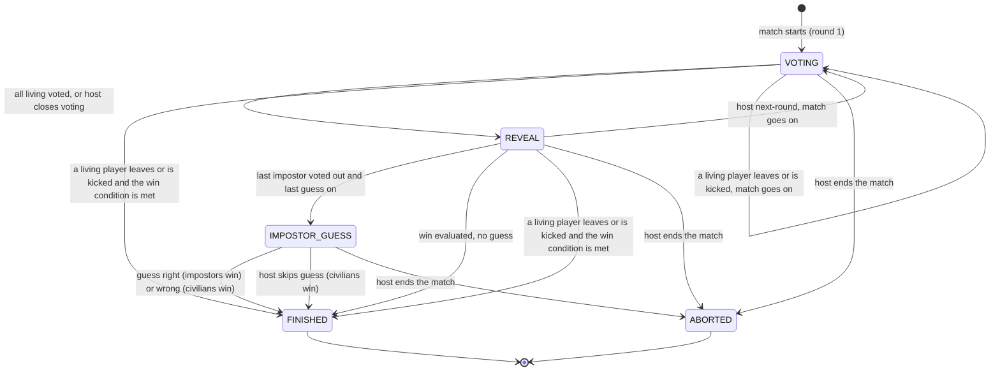

# Impostor: flows

## Match phases

The public phase of a running match, driven by votes, host actions and members leaving.
Aborting is a match status, not a phase, so it can happen from any state.
Per-state rules are in [prd.md](prd.md).

- A vote that ends the match passes through `REVEAL`; the host moves everyone to `FINISHED` with "Ver resultado".
- A leaving or kicked living player is recorded as eliminated with reason `LEFT` or `KICKED` and the win is evaluated; a last impostor who leaves gives the civilians the win without a last guess.
- After `FINISHED` or `ABORTED` the host goes back to the lobby or starts a rematch; both belong to `platform`.
