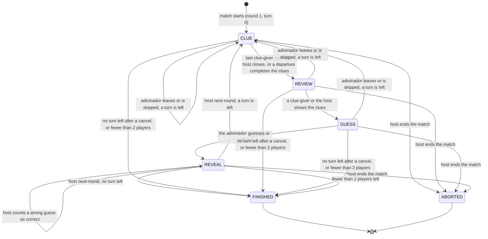

# Just One: flows

## Match phases

`round` rises with every opened round, cancelled ones included; `turn` walks the `cycles` times `order` sequence, skipping players who left.

- A cancelled round records `skipped` (who and why), shown during the next CLUE until the review opens.
- After `FINISHED` or `ABORTED` the host goes back to the lobby or starts a rematch; both belong to `platform`.
