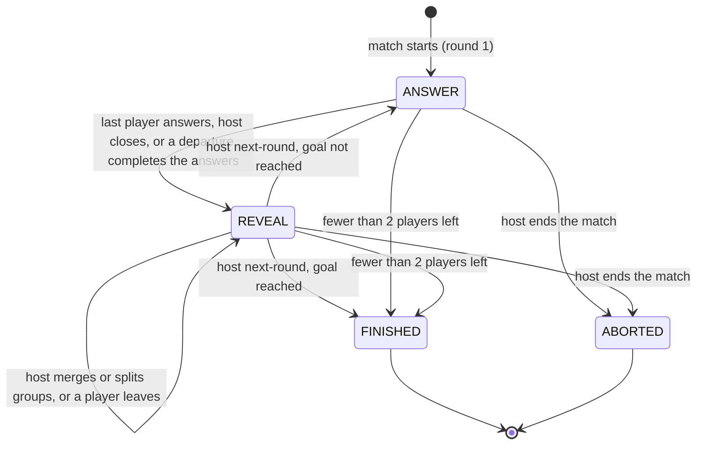

# La manada: flows

## Match phases

- The goal is reached at the last configured round, or with "8 puntos" when someone without the cow has 8 or more; the reveal's button reads "Ver resultado" then.
- After `FINISHED` or `ABORTED` the host goes back to the lobby or starts a rematch; both belong to `platform`.
