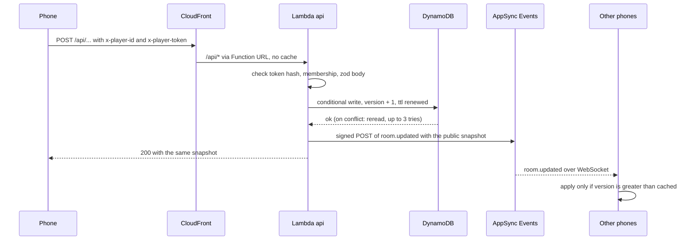
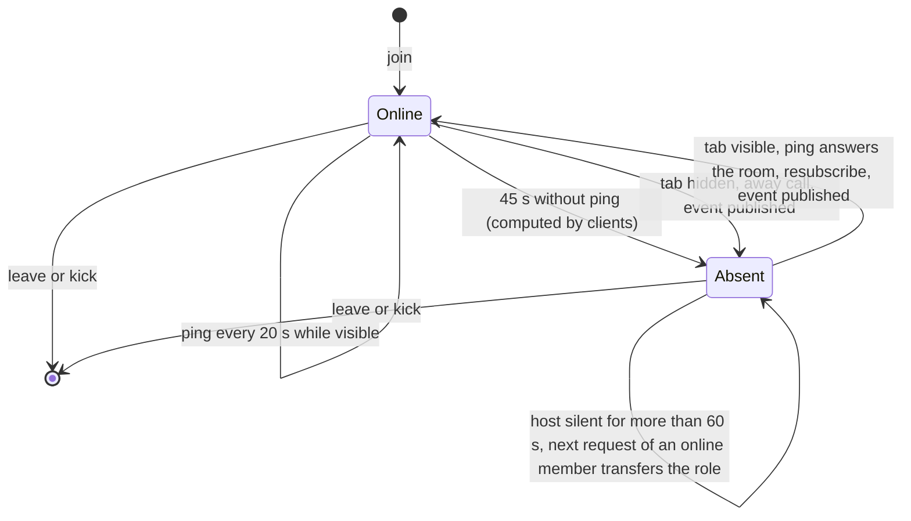

# Platform: flows

## Command flow

Every action of every game follows this path; clients never publish to the channel.

If the publish fails the request still succeeds, and phones resync on their next event or reconnect.
On every subscription, the first and each after a reconnect, a phone refetches `GET /api/rooms/{code}`; on return to the foreground it pings, and the ping answers the room.

## Presence states

A member is online while the last sign of life is under 45 s old; the client recomputes this every 5 s, so going offline sends no event.

