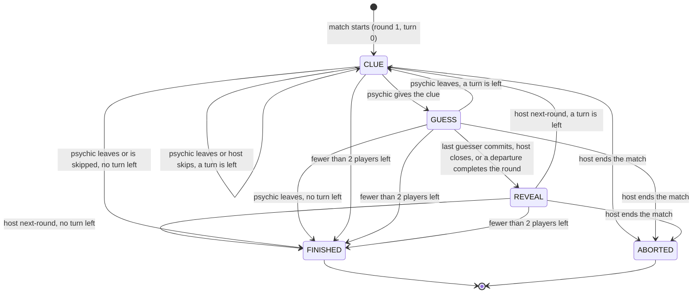
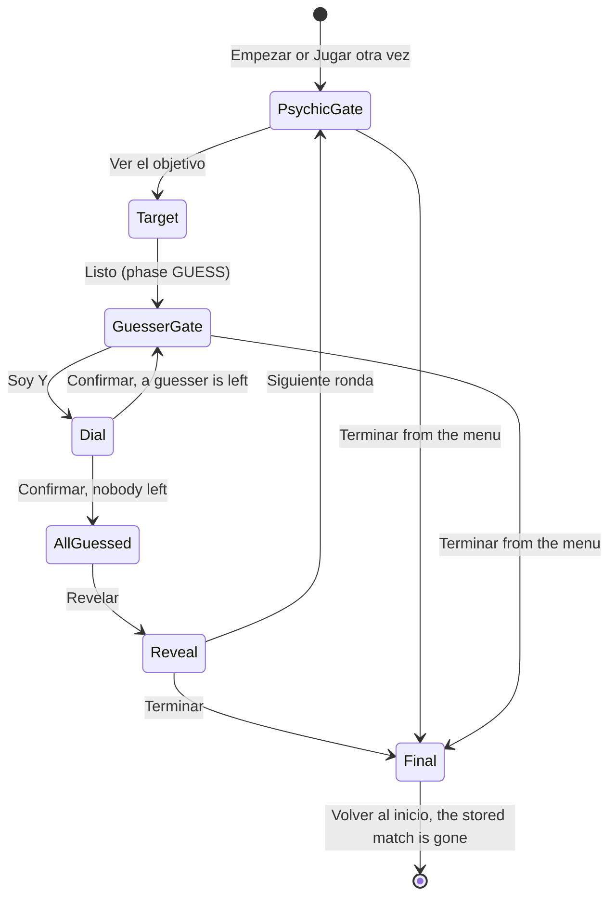

# Wavelength: flows

## Match phases

`round` rises with every opened round, cancelled ones included; `turn` walks the `cycles` times `order` sequence, skipping players who left.

- A cancelled round records `skipped` (who and why), shown in the next CLUE until the clue is given.
- After `FINISHED` or `ABORTED` the host goes back to the lobby or starts a rematch; both belong to `platform`.

## One device steps

Only CLUE, GUESS and REVEAL are stored; the open target and an open dial live in memory, so a reload lands on the gate before them.

